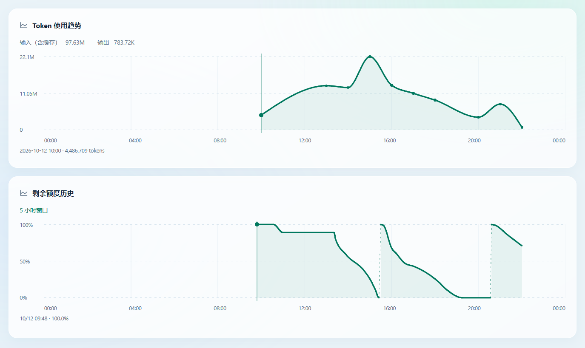

# 曲线平滑（2.8.4）

本文记录 2.8.4 的平滑算法及路径构建测量。2.8.5 保留该插值算法，增加后台曲线图层和交互缓存；实际绘制 / 动画开销见 [长历史图表性能](chart-performance.md)。

Token 总量、输出与 USD 趋势使用同一条连续曲线，替换尖角折线和每点停顿的旧 USD 插值。额度历史也使用平滑趋势，减少密集、取整采样形成的小阶梯。配色、线宽、布局、入场动画和减少动态效果设置沿用原样。



## 数据含义

曲线采用 [Steffen 单调三次插值](https://d3js.org/d3-shape/curve#curveMonotoneX)，相邻曲段拥有相同的一阶切线，不产生超出相邻保留点范围的新峰谷。Token / 输出 / USD 曲线经过全部有效记录；额度曲线经过保留的原始采样点。同时间的数值跳变继续直连，避免除零或伪造时间跨度。

额度图的精简只作用于绘制几何，按时间顺序一次扫描，保留首尾及方向反转处的峰谷。省略点相对于保留点间**直线弦**的垂直误差最多为线宽的一半，即 1.25 DIP；150 DIP 高的图表中相当于约 0.91 个百分点。这个误差界限针对精简的直线弦，后续曲线插值不具有同一个误差界限。长时间的平台会保留水平部分。重置与采样空档先分段再精简，重置保持虚线提示，空档不连接、不填充。

数据库、统计汇总和原始采样数组均不修改。悬停和左右方向键、Home / End 继续定位全部原始记录，提示显示记录的真实时间与数值。因此图形表示采样之间的趋势，并不宣称每个中间时刻的实际额度已被测量。

## 绘制开销

使用 `chartPreviewPoints` 中 738 条合成额度采样，包含三个重置周期、长平台、连续下降和 1% 取整阶梯。150 DIP 高的图表只需 25 个绘制点，减少 96.6%；这不减少可查看的记录数。线条和填充区域共用曲线路径前缀，避免重复构建。

同一机器、Go 1.27.1、三轮 1 秒基准测试中位数：

| 每次完整额度路径构建 | 旧阶梯及独立填充 | 平滑曲线及共用填充 | 变化 |
| --- | ---: | ---: | ---: |
| 用时 | 67.081 μs | 11.070 μs | −83.5% |
| 内存分配 | 269,874 B | 7,712 B | −97.1% |
| 分配次数 | 64 | 19 | −70.3% |

旧用时三轮为 63.070 / 67.081 / 75.916 μs，新用时为 11.099 / 11.021 / 11.070 μs。此基准只测**路径构建**，包含分段、额度绘制点精简、曲线与填充命令，不包含栅格化、GPU、整个 GUI 帧或进程常驻内存。数据密度与走势会影响实际收益；没有新增依赖或常驻图表缓存，2.8.3 的 GUI 内存策略保持原样。

Windows 安装包为 7,883,474 B，比 2.8.3 增加 1,386 B（约 0.018%）。预览图片仅用于仓库文档，不嵌入安装包。

## 验证与复现

随机不等间距序列覆盖连续升降、峰谷与平台，逐段采样检查曲线不越界。精简验证原记录未变、首尾与峰谷保留、弦误差受限，并覆盖重复时间。界面验证悬停与键盘能选中被省略的绘制点，浅色 / 深色空档不连接，125% / 150% / 200% DPI 的实际绘制效果见上图。完整原生验收还覆盖五个页面、窗口控制、小窗口及隐藏后恢复。

```powershell
# 定位本机 Go，运行精确数据与交互测试
$go = node -p "require('./scripts/go.cjs')"
& $go test ./internal/nativeapp -run 'TestChart|TestQuotaSegments' -count=1
& $go test -race ./internal/nativeapp -run 'TestChart|TestQuotaSegments' -count=1

# false 为原阶梯路径构建，true 为平滑版本
& $go test ./internal/nativeapp -run '^$' -bench '^BenchmarkChartDenseQuota$' -benchmem -benchtime=1s -count=3
npm run native:check
```

设置 `MONITOR_NATIVE_CAPTURE` 为输出目录后运行 `TestChartSmoothPreview`，可生成浅色、深色与高 DPI 预览。全部预览使用合成数据，无需读取个人日志或账号。
